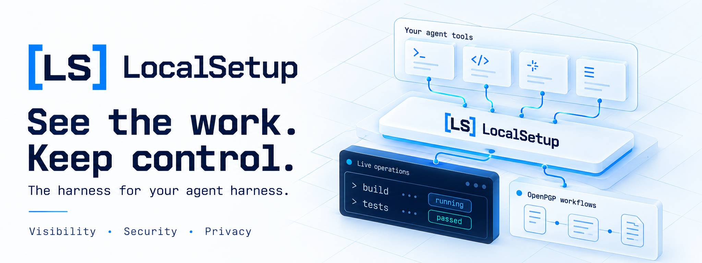

# LocalSetup

<p align="center">
  <picture>
    <source media="(prefers-color-scheme: dark)" srcset="assets/localsetup-readme-hero-dark.png">
    <source media="(prefers-color-scheme: light)" srcset="assets/localsetup-readme-hero.png">
    
  </picture>
</p>

### See the work. Keep control.

**The harness for your agent harness.**

LocalSetup (LS) adds shared project context, reusable workflows, visible operations, and explicit control boundaries around the AI tools you already use. It helps you carry your standards between supported clients and inspect managed work outside the conversation.

**Visibility. Security. Privacy.** See live commands in an owned terminal companion. Define authority before sensitive operations. Use shared OpenPGP capabilities for supported signed and encrypted workflows. Keep private operational evidence separate from material intended for publication.

AI is a tool. Expertise determines what it multiplies. LocalSetup brings engineering discipline to AI-assisted work: clear scope, observable execution, tested procedures, and evidence you can review.

[Read the complete story](ls/docs/WHY_LOCALSETUP.md) · [Explore the capabilities](ls/docs/FEATURES.md) · [Understand the security boundaries](SECURITY.md)

## See LocalSetup in action

Watch a Codex session work through a simulated coding task while LocalSetup's
terminal companion shows commands, results, and layout controls. The full demo
is silent and runs for about six minutes.

[](https://cdn.cruxexperts.com/localsetup/demos/codex-observer-b8b5a3e9a5cf/demo.mp4)

[Watch the full demo](https://cdn.cruxexperts.com/localsetup/demos/codex-observer-b8b5a3e9a5cf/demo.mp4).

## An operating layer around your tools

**Carry your context forward.** Keep project instructions, architectural decisions, and engineering standards in reviewable files. Reuse them across projects and supported clients instead of reconstructing them for each conversation.

**Reuse proven actions.** Selected skills and workflows give agents a practical reference for implementation, tests, documentation, infrastructure, and maintenance. Client loading rules and native permissions remain in force.

**See work as it happens.** LocalSetup's managed tmux workflow exposes live operations in persistent native panes, with protected observation and explicit input handoffs. It provides an operator view of work dispatched through that workflow—not surveillance of every client action. [Terminal capabilities and prerequisites](ls/docs/TMUX_TERMINAL_MODE.md).

**Control sensitive workflows.** Shared OpenPGP tools support explicit trust, signatures, encrypted envelopes, and protected artifacts. Installation does not enroll trust or encrypt every file. The optional integrated [LSCli runtime](ls/docs/LSCLI.md) provides its own qualified grants and access controls; external clients retain their security models.

**Keep improving between sessions.** Opt-in [heartbeat automation](ls/docs/HARNESS_AUTOMATION.md) can collect evidence and perform a configured review in a separate run. Scheduling and agent execution require explicit setup. Reusable context, maintenance records, and handoffs make ongoing work easier to resume.

**Recognize owned workloads.** Shared [process and container naming](ls/docs/COMMAND_REFERENCE.md#process-and-container-display-names)
uses public application and command context, keeps native identifiers authoritative,
and reports unsupported or shortened names. Container object names and names of
processes inside them are separate surfaces; arbitrary workloads must cooperate
after exec. See the [supported naming boundaries](ls/docs/BRANDING.md#generated-display-text).

Managed terminal [cleanup](ls/docs/TMUX_TERMINAL_MODE.md) can collect eligible
sessions after their owners exit without adopting or replaying commands. Live
workloads and uncertain ownership are preserved; incomplete cleanup returns a
nonzero status rather than claiming removal.

<details>
<summary>Library size and supported clients</summary>

<!-- facts-block:start -->
| Fact | Value |
|---|---|
| Current version | `4.94.0` |
| Supported platforms | `codex, claude-code, cursor, kilo, opencode, openclaw, github-copilot-cli, github-copilot-vscode, cline-cli, cline-vscode, amp-cli, goose-cli, pi-cli, hermes-agent, qwen-code-cli, kimi-cli, factory-droid, antigravity-app, gemini-cli, omp-cli` |
| Shipped skills | `115` |
| Workflow packages | `22` |
| Source | `ls/docs/_generated/facts.json` |
<!-- facts-block:end -->

</details>

## Expertise behind the system

LocalSetup is developed by Crux Experts LLC, grounded in its founder's 35 years of hands-on engineering—from Netscape-era websites in 1995 through networks, protocol stacks, servers, data centers, and software. That includes more than nine years owning a web hosting company, growing it from a bootstrapped bedroom operation into an office with employees before selling it.

**AI is a force multiplier for that experience.** Continued research, maintenance, and custom integration keep the system useful as tools and requirements change. The value is a maintained operating foundation backed by practical engineering judgment.

## Useful service for small businesses

Start with the business, identify work worth improving, and measure the result. A focused integration should demonstrate time saved, fewer errors, or lower operating cost against a real baseline. LocalSetup supports that work; the service is the expertise to choose the right opportunity and deliver it responsibly.

For commercial inquiries and integration services, visit [Crux Experts](https://www.cruxexperts.com/). Read [the engineering and service philosophy](ls/docs/WHY_LOCALSETUP.md#practical-service-for-small-businesses).

## Part of the CruxExperts ecosystem

LocalSetup is part of the [CruxExperts ecosystem](https://github.com/CruxExperts), a collection of independently useful development and operations tools. Each project has its own licensing and operational scope.

**[Envman](https://github.com/CruxExperts/EnvMan)** manages environment variables and sensitive configuration. LocalSetup supports optional installation and update checks while leaving Envman's private configuration under its own control.

**[bbackup (BestBackup)](https://github.com/CruxExperts/BestBackup)** provides encrypted Linux file backups, verified file restores, and a structured command interface for automation. It is a complementary, separately managed tool.

## Get started

Use an interactive Bash terminal on Linux or macOS, or Windows through WSL2. You'll need Git, Python 3.12 or later, `uv`, and internet access to GitHub. See the [requirements](ls/docs/QUICKSTART.md#requirements) for details.

```bash
curl -sSL https://raw.githubusercontent.com/CruxExperts/localsetup/main/install | bash -s --
```

The guided installer explains the options, lets you select packages and supported AI clients, and previews changes before applying them.

- [Getting started](ls/docs/QUICKSTART.md)
- [Features and capabilities](ls/docs/FEATURES.md)
- [Skills catalog](ls/docs/SKILLS.md)
- [Supported AI platforms](ls/docs/PLATFORM_REGISTRY.md)
- [Workflow packages](ls/docs/WORKFLOW_PACKAGES.md)
- [All documentation](ls/docs/README.md)

## Release notes

[View the latest release](https://github.com/CruxExperts/localsetup/releases/latest).

<details>
<summary>Release included in this checkout</summary>

**Version:** 4.94.0<br>

<!-- release-summary:start -->
## What's new in 4.94.0

This unpublished LocalSetup candidate adds compact workload command context and safer abandoned-terminal collection, carrying forward the reviewed maintenance since v4.89.10. Branch publication is not release acceptance.

- Recognize cooperative workloads through one shared resolver, formatter and native readback check. Keep application identity, declared command layers, observed ancestry, caller assertions and verified LocalSetup package versions distinct. Compact names mark abbreviations and omitted layers while retaining application, leaf and instance suffix where representable.
- Create explicitly requested Docker or Podman containers with names selected from the complete engine inventory, including stopped containers, and verify by native container ID. Preserve orchestrator-owned names and report inner-process naming separately.
- Collect eligible abandoned native terminal sessions through the supported independent collector without adopting or replaying commands. Preserve live workloads, admitted members, attached viewers and uncertain native state. Waiting controllers avoid rewriting unchanged session state; partial collection returns a nonzero result.
- Carry forward controller-owned remote diagnostics, private diagnostic staging, managed-generation absence fencing, the user file-organization workflow and centralized configuration-backup guidance. These changes do not authorize host mutation, deployment or automatic session transfer.
- Retain the reviewed dependency, SDK helper-permission, terminal startup and recovery maintenance described in the earlier unpublished guides. Their recorded evidence remains limited to the exact tested snapshots.

See the [4.94.0 release guide](ls/docs/releases/4.94.0.md) for compatibility, updating, and verification.
<!-- release-summary:end -->

</details>

## Available source. Experienced support.

LocalSetup is developed by [Crux Experts LLC](https://www.cruxexperts.com/). Current first-party source is free for noncommercial use under [PolyForm Noncommercial 1.0.0](LICENSE); commercial use requires a separate license. See [licensing scope](ls/docs/LICENSING.md) for earlier MIT grants and separately licensed components. Commercial inquiries are welcome through the company website.

Establish standards, preserve useful knowledge, and build a more consistent development environment around the AI tools you already use.

**Own your stack. Standardize your agents. Automate the work.**

For questions, start a [GitHub Discussion](https://github.com/CruxExperts/localsetup/discussions). For bugs and feature requests, see [Support](SUPPORT.md). Report security issues using [SECURITY.md](SECURITY.md).

Copyright © 2026 Crux Experts LLC. See [contribution and attribution notes](CONTRIBUTING.md#attribution).
