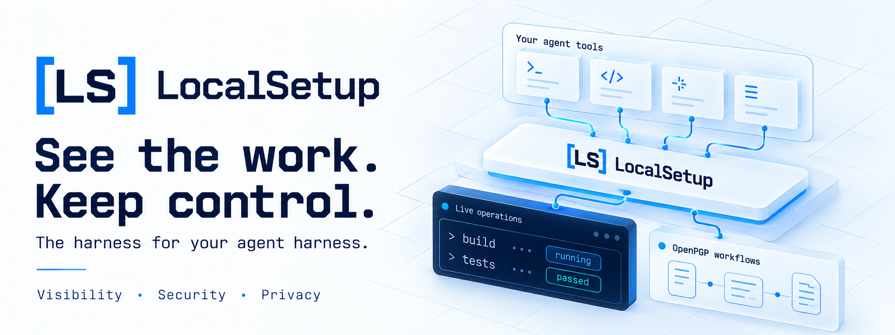

# LocalSetup

<p align="center">
  <picture>
    <source media="(prefers-color-scheme: dark)" srcset="assets/localsetup-readme-hero-dark.png">
    <source media="(prefers-color-scheme: light)" srcset="assets/localsetup-readme-hero.png">
    
  </picture>
</p>

### One framework. Multiple AI agents. Your rules.

**Give your AI coding agents a shared standard for how to work.**

Switching between Codex, Claude Code, Cursor, and other coding tools often means repeating instructions and explaining your development standards all over again.

LocalSetup (LS) is a free, open-source operating framework for consistent, standards-driven AI development. It brings your project context, coding standards, reusable skills, and development workflows into one organized system.

**Set your standards once. Reuse them across projects and supported AI agents.**

Your practices live in version-controlled files that you can review, maintain, and reuse beyond any single conversation. Your agents get a lasting reference for how you expect projects to be built, tested, and managed.

## A foundation for AI development

**Persistent project context.** Keep architectural decisions, coding conventions, and project instructions in a reviewable reference. Make useful knowledge available to future sessions through files your agents can read.

**Reusable skills and workflows.** A skill gives an agent instructions for a task. A workflow guides it through a series of steps. Choose from the library for coding, debugging, testing, documentation, reviews, infrastructure, security, and automation.

**Engineering standards in practice.** Give agents clear procedures for checking their work, documenting changes, and handling operations safely. Define your approval boundaries alongside your quality requirements.

**Consistent standards across tools.** Use a shared library with Claude Code, OpenAI Codex, Cursor, Kilo, OpenCode, GitHub Copilot, Gemini CLI, and other [supported clients](ls/docs/PLATFORM_REGISTRY.md). Select the packages each project needs while preserving your existing tools and custom configurations. Each client still follows its own loading rules and permissions.

**Work you can resume.** Use documented steps, checkpoints, verification, and handoffs to make complex tasks easier to pick up after an interruption or transfer to another agent or developer.

**Your environment, your control.** Preview installation changes, inspect managed state, and use recorded rollback information to restore managed paths when needed.

<details>
<summary>Library size and supported clients</summary>

<!-- facts-block:start -->
| Fact | Value |
|---|---|
| Current version | `4.84.1` |
| Supported platforms | `codex, claude-code, cursor, kilo, opencode, openclaw, github-copilot-cli, github-copilot-vscode, cline-cli, cline-vscode, amp-cli, goose-cli, pi-cli, hermes-agent, qwen-code-cli, kimi-cli, factory-droid, antigravity-app, gemini-cli, omp-cli` |
| Shipped skills | `115` |
| Workflow packages | `21` |
| Source | `ls/docs/_generated/facts.json` |
<!-- facts-block:end -->

</details>

## Put your standards to work

Start with a project you already maintain. Define its coding conventions, preferred architecture, testing requirements, documentation rules, and approval boundaries.

LocalSetup helps organize that knowledge alongside reusable capabilities and makes selected packages available to your supported agents. When you switch tools or start another project, reuse the relevant standards and add the instructions specific to that project.

That means less repeated setup and a clearer reference for everyone working on the code, whether you're developing independently, maintaining infrastructure, or collaborating across repositories.

**Your knowledge stays with your development environment, where you can review and improve it.**

## Part of the CruxExperts ecosystem

LocalSetup is part of the [CruxExperts open-source ecosystem](https://github.com/CruxExperts), a collection of independently useful tools for development and operations.

**[Envman](https://github.com/CruxExperts/EnvMan)** manages environment variables and sensitive configuration. LocalSetup supports optional installation and update checks while leaving Envman's private configuration under its own control.

**[bbackup (BestBackup)](https://github.com/CruxExperts/BestBackup)** provides encrypted Linux file backups, verified file restores, and a structured JSON command interface for automation and AI agents. It complements LocalSetup's development guidance as a separate tool.

The aim is to grow this collection around compatible practices for development, automation, security, and recoverable operations. LocalSetup provides a shared framework for those practices.

## Get started

Use an interactive Bash terminal on Linux or macOS, or Windows through WSL2. You'll need Git, Python 3.12 or later, `uv`, and internet access to GitHub. See the [requirements](ls/docs/QUICKSTART.md#requirements) for details.

```bash
curl -sSL https://raw.githubusercontent.com/CruxExperts/localsetup/main/install | bash -s --
```

The guided installer explains the options, lets you select packages and supported AI clients, and previews changes before applying them.

- [Getting started](ls/docs/QUICKSTART.md)
- [Features and capabilities](ls/docs/FEATURES.md)
- [Skills catalog](ls/docs/SKILLS.md)
- [Supported AI platforms](ls/docs/PLATFORM_REGISTRY.md)
- [Workflow packages](ls/docs/WORKFLOW_PACKAGES.md)
- [All documentation](ls/docs/README.md)

## Release notes

[View the latest release](https://github.com/CruxExperts/localsetup/releases/latest).

<details>
<summary>Release included in this checkout</summary>

**Version:** 4.84.2<br>

<!-- release-summary:start -->
## What's new in 4.84.2

LocalSetup 4.84.2 adds a dynamic terminal workspace, private input dialogs, encrypted artifact workflows, and an installed agent runtime with bounded controls and recovery.

- **Check before scheduling:** the cron readiness command reports observable prerequisites, blockers, unchecked requirements, and next actions without running or enabling a task.
- **Review guidance before retirement:** assess accuracy, review age, historical value, dependent instructions, and the limits of a usage search before changing or retiring a reference.
- **Understand recovery confidence:** report backup attempts, integrity checks, and successful recovery exercises separately, then prepare an isolated exercise that protects originals.
- **Resume a contribution:** follow receiving-project rules and keep work, review readiness, submission readiness, and confirmed submission visible in one private progress record.
- **Continue settled LSCli history in another workspace:** select the source with `--source-workspace` and the destination with `--workspace`; the new session retains exact history while requiring fresh authority.
- **Explain an unfamiliar tool from source:** write an operational reference tied to a reviewed revision, with source citations, coverage, failure and recovery behavior, and visible unresolved questions.
- **Manage local previews safely:** guide existing project commands through verified loopback startup, reuse, inspection, conflict handling, and stopping only the owned preview.
- **Prepare media metadata copies:** choose hidden fields to retain, remove, or update, preserve original files and legitimate attribution, and verify each output against the chosen policy.
- **Prepare private transcripts and captions:** check local processing capability, mark drafts, review words and timing, export sidecar captions, and optionally render a separate captioned video.
- **Follow active work in the terminal:** dormant sections collapse to one row, active work expands below them, and paging preserves configurable minimum heights. Readable controls and selection redraws support keyboard and mouse use.
- **Enter private input through reusable dialogs:** text, multiline, password, checkbox, radio and confirmation fields use bounded, operation-bound delivery. Sudo and OpenPGP consumers retain their own authority checks.
- **Share encrypted files across carriers:** protected metadata, per-file messages, recipient addressing, volume reconstruction and persistent receipts preserve verification independently of storage or transport accounts.
- **Read protected files through ordinary tools:** configured catalogs resolve encrypted volumes and delta dependencies beneath explicit file and disclosure grants. Models do not select keys or bypass verification.
- **Preserve independent origins and concurrent edits:** bounded admissions retain each origin’s trust and receipts. Common-base forks remain separate until an explicitly authored merge creates a new immutable version.
- **Resume authorized snapshot publication:** exact coverage, current assignments and durable job identity govern client, worker and on-demand consolidation. Lost acknowledgements require reconciliation rather than duplicate publication.
- **Apply signed configuration at defined boundaries:** terminal tuning, container settings and ordered output filters consume validated revisions while preserving running operation identity.
- **Run coding tools behind explicit grants:** installed workers use the shared file, process and provider brokers. Private credentials stay outside worker environments, and cancellation remains available during stalled output.
- **Control and reconcile admitted runs:** one authenticated encrypted protocol carries bounded requests over owned streams, SSH relay processes and HTTP adapters. A fresh read-only recovery session can inspect an original run without replaying it.
- **Prepare installed heartbeat reviews:** explicit profiles, secret references, readiness checks and granted tool-free review support scheduled observation without treating configuration as activation authority.
- **Install verified runtime assets:** authenticated release sets and hash-locked dependency preparation support offline installation, protected launchers and retained predecessors.
- **Bound retained observations and provider context:** ordered filter policies, retained event limits and explicit context selection govern what resumed runs see, while preserving signed protocol fields and raw files.

See the [4.84.2 release guide](ls/docs/releases/4.84.2.md) for compatibility, updating, and verification.
<!-- release-summary:end -->

</details>

## Open source. Built for the long term.

LocalSetup is developed by [Crux Experts LLC](https://www.cruxexperts.com/) and released under the [MIT License](LICENSE). Use it with your preferred coding assistants and your existing model access.

Establish standards, preserve useful knowledge, and build a more consistent development environment around the AI tools you already use.

**Own your stack. Standardize your agents. Automate the work.**

For questions, start a [GitHub Discussion](https://github.com/CruxExperts/localsetup/discussions). For bugs and feature requests, see [Support](SUPPORT.md). Report security issues using [SECURITY.md](SECURITY.md).

Copyright © 2026 Crux Experts LLC. See [contribution and attribution notes](CONTRIBUTING.md#attribution).
