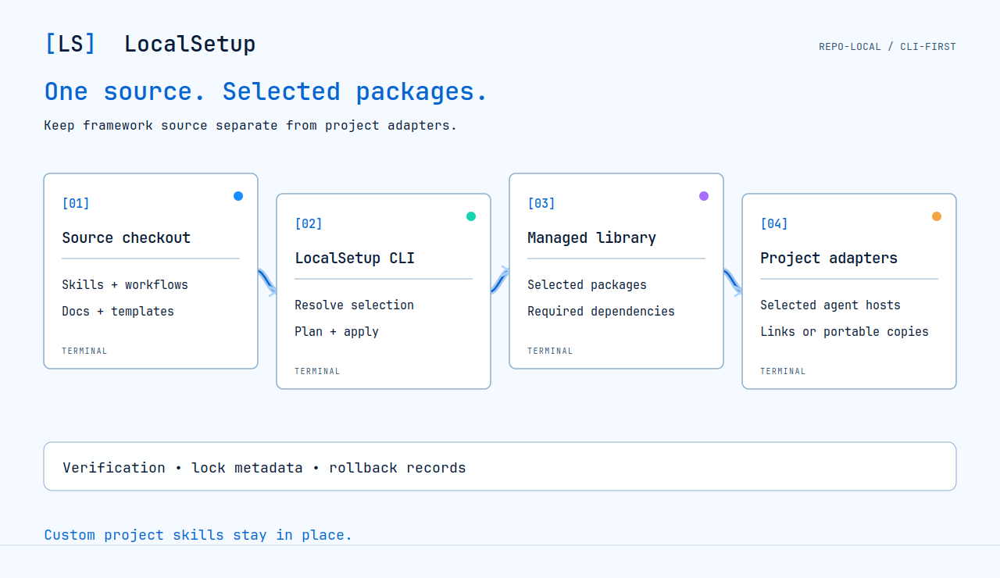
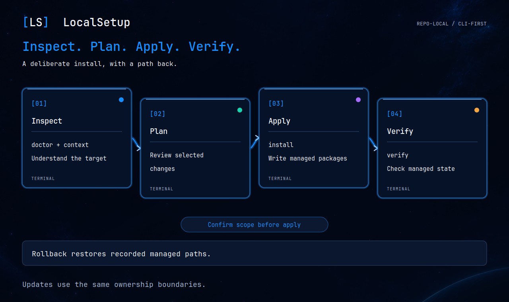

# LocalSetup

<p align="center">
  <picture>
    <source media="(prefers-color-scheme: dark)" srcset="assets/localsetup-readme-hero-dark.png">
    <source media="(prefers-color-scheme: light)" srcset="assets/localsetup-readme-hero.png">
    
  </picture>
</p>

<p align="center">
  <a href="LICENSE"></a>
  <a href="https://agentskills.io/specification"></a>
  <a href="ls/docs/PLATFORM_REGISTRY.md"></a>
</p>

**Version:** 4.52.2<br>

**Spend less time setting up your AI assistants.**

LocalSetup organizes the instructions and skills your AI coding tools need for everyday project work. Reuse a setup that works, choose the help you need for each project, and keep your own instructions alongside it.

Give your assistant a repeatable way to review changes, write documentation, troubleshoot problems, and handle other routine tasks. LocalSetup works with tools such as Cursor, Claude Code, and Codex; you use it with your existing AI tool and model access.

Start with the [quickstart](ls/docs/QUICKSTART.md), browse the [documentation index](ls/docs/README.md), or see the [latest release](https://github.com/CruxExperts/localsetup/releases/latest).


## Why use LocalSetup

- **Save time on repeat work.** Reuse useful instructions across projects instead of rebuilding your setup each time.
- **Make tasks easier to follow.** Give your assistant clear steps for reviews, troubleshooting, documentation, and more.
- **Keep control of your setup.** Choose the help each project gets and keep your own project instructions.
- **Know what will change.** Preview installation changes, check the result, and use recorded rollback information if you need to undo managed changes.

## What you get

A **skill** gives your assistant reusable instructions for a task. A **workflow** guides it through a series of steps. LocalSetup brings them into one library and makes your chosen ones available in the AI tools you use.

<details>
<summary>Full tool list and collection size</summary>

<!-- facts-block:start -->
| Fact | Value |
|---|---|
| Current version | `4.52.2` |
| Supported platforms | `codex, claude-code, cursor, kilo, opencode, openclaw, github-copilot-cli, github-copilot-vscode, cline-cli, cline-vscode, amp-cli, goose-cli, pi-cli, hermes-agent, qwen-code-cli, kimi-cli, factory-droid, antigravity-app, gemini-cli, omp-cli` |
| Shipped skills | `113` |
| Workflow packages | `20` |
| Source | `ls/docs/_generated/facts.json` |
<!-- facts-block:end -->

</details>

## How it works

1. **Choose your AI tool.** Select the tools you already use for project work.
2. **Pick useful skills.** Start with the included collection and choose what each project needs.
3. **Reuse your setup.** Keep your instructions organized as you move between projects or tools.

<p align="center">
  <picture>
    <source media="(prefers-color-scheme: dark)" srcset="assets/localsetup-architecture-dark.png">
    <source media="(prefers-color-scheme: light)" srcset="assets/localsetup-architecture.png">
    
  </picture>
</p>

## Install from a terminal

Use an interactive Bash terminal on Linux or macOS. On Windows, use WSL2. You will need Git, Python 3.12 or later, and `uv` to install Python dependencies, plus internet access to GitHub. The [getting started guide](ls/docs/QUICKSTART.md#requirements) covers the requirements.

Copy and run:

```bash
curl -sSL https://raw.githubusercontent.com/CruxExperts/localsetup/main/install | bash -s --
```

The guided setup explains your choices and shows what it will change before asking you to continue. See the [getting started guide](ls/docs/QUICKSTART.md) for installation options, choosing skills, updates, and checking your setup.

<p align="center">
  <picture>
    <source media="(prefers-color-scheme: dark)" srcset="assets/localsetup-install-lifecycle-dark.png">
    <source media="(prefers-color-scheme: light)" srcset="assets/localsetup-install-lifecycle.png">
    
  </picture>
</p>

## Supported tools and useful guides

Use LocalSetup with Cursor, Claude Code, OpenAI Codex CLI, OpenClaw, Kilo, OpenCode, and other [supported tools](ls/docs/PLATFORM_REGISTRY.md).

- [Feature overview](ls/docs/FEATURES.md): what LocalSetup can do.
- [Skills catalog](ls/docs/SKILLS.md): find help for tasks you do regularly.
- [Workflow guide](ls/docs/WORKFLOW_PACKAGES.md): put repeat tasks into clear steps.
- [Workflow quick reference](ls/docs/WORKFLOW_QUICK_REF.md): browse the available workflows.
- [All documentation](ls/docs/README.md): installation, usage, and maintainer guides.

<!-- release-summary:start -->
## What's new in 4.52.2

LocalSetup 4.52.2 makes it easier to choose, set up, and reuse skills for your AI assistants. This release also brings guided GitHub upkeep, reusable setup handoffs, and more reliable remote work.

- **Understand the product faster:** the refreshed homepage explains what LocalSetup does, how it helps with everyday tasks, and how to get started, using plain language.
- **Keep your GitHub project easier to maintain:** choose optional guidance for reviewing changes, reporting problems, and checking dependencies while keeping the tools and rules you already use.
- **Turn a successful setup into reusable help:** save a completed setup as a skill with its source and helper files, so it is easier to repeat or hand over.
- **Manage remote work with clearer safeguards:** the Herdr tools help organize terminal work, track completed commands, and handle remote setup, configuration, and restarts. They check ownership and active work before making changes.
- **Keep unfinished checks from getting lost:** maintenance checks retain current observations between runs. Missing history pauses actions until it is explicitly recovered, helping avoid repeated requests.
- **Refresh the Python dependencies:** update two libraries and keep their checked installation files aligned.

See the [4.52.2 release guide](ls/docs/releases/4.52.2.md) for compatibility, updating, and verification.
<!-- release-summary:end -->

## Help, license, and attribution

For usage questions, start a [GitHub Discussion](https://github.com/CruxExperts/localsetup/discussions). For bug reports or feature requests, use [Support](SUPPORT.md). Report security issues using the instructions in [SECURITY.md](SECURITY.md).

Copyright © 2026 Crux Experts LLC. LocalSetup is released under the [MIT License](LICENSE). See [contribution and attribution notes](CONTRIBUTING.md#attribution).
